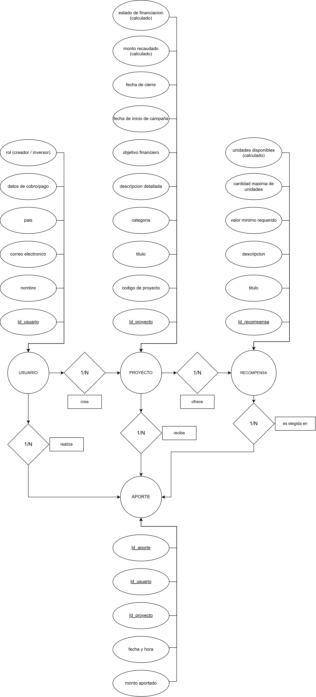

# BASE DE DATOS — Ejercicio 19: Plataforma de Crowdfunding y Gestión de Proyectos de Inversión

Trabajo práctico de Base de Datos (Universidad Champagnat). Este repositorio contiene todo el desarrollo del ejercicio 19: modelo entidad-relación, modelo relacional y normalización (1FN, 2FN y 3FN).

## Consigna


#### Contexto

Una plataforma web de micromecenazgo (crowdfunding) conecta a creadores de proyectos innovadores con inversores o mecenas que aportan capital a cambio de recompensas futuras o participación simbólica.


#### Consigna

Diseñar el modelo conceptual de datos para la plataforma de inversión colectiva basándose en los siguientes requerimientos:

Los usuarios de la plataforma pueden registrarse como Creadores (quienes publican proyectos) o Inversores (quienes aportan fondos), almacenando ID de usuario, nombre, correo, país y datos de cobro/pago.

Los proyectos se identifican por un código de proyecto, título, categoría (TecNología, Arte, Social, Videojuegos), descripción detallada, objetivo financiero (monto en dinero buscado), fecha de inicio de campaña y fecha de cierre. Todo proyecto es creado por un único usuario creador.

Los proyectos ofrecen diferentes niveles de recompensa (Tiers) para incentivar el aporte de los inversores. Cada recompensa posee un identificador, título, descripción de lo que incluye, valor mínimo en dinero requerido y la cantidad máxima de unidades disponibles.

Los inversores realizan aportes (pledges) a los proyectos. Cada aporte registra la fecha y hora de la transacción, el monto aportado y la recompensa seleccionada por el inversor.

Se debe registrar el estado de financiación del proyecto (Financiado con éxito, No alcanzado, En curso) en función de si se logró recaudar el objetivo financiero antes de la fecha de cierre.


#### Desarrollo requerido


Modelar las entidades principales Usuario (con roles de creador/inversor), Proyecto y Recompensa.

Establecer la relación de dependencia 1:N entre Proyecto y sus niveles de Recompensa.

Diseñar la entidad asociativa Aporte (Inversión) que vincula al Inversor, al Proyecto y a la Recompensa seleccionada.

Analizar los atributos calculados y de control temporal necesarios para validar el éxito de la campaña de recaudación.

## Estructura del repositorio

```
BASE_DE_DATOS_Ejercicio_19/
├── README.md
├── modelo-er/
│   ├── ejercicio_19.drawio        # diagrama editable (draw.io)
│   └── ejercicio_19.png           # exportación del diagrama
├── modelo-relacional/
│   ├── ejercicio_19_MR.xlsx               # modelo relacional
│   └── ejercicio_19_con_datos.xlsx        # modelo relacional con datos de ejemplo
└── normalizacion/
    ├── ejercicio_19_1FN.xlsx
    ├── ejercicio_19_2FN.xlsx
    └── ejercicio_19_3FN.xlsx
```

## Modelo entidad-relación



Archivo editable: [`modelo-er/ejercicio_19.drawio`](modelo-er/ejercicio_19.drawio).

## Modelo relacional

Tablas del modelo relacional original, antes de normalizar (`(PK)` clave primaria, `(FK)` clave foránea, `(UNIQUE)` valor único):

- **USUARIO**: `Id_usuario(PK)`, `nombre`, `correo electronico`, `pais`, `datos de cobro/pago`, `rol (creador / inversor)`
- **PROYECTO**: `Id_proyecto(PK)`, `codigo de proyecto(UNIQUE)`, `titulo`, `categoria`, `descripcion detallada`, `objetivo financiero`, `fecha de inicio de campaña`, `fecha de cierre`, `Id_usuario(FK)`
- **RECOMPENSA**: `Id_recompensa(PK)`, `titulo`, `descripcion`, `valor minimo requerido`, `cantidad maxima de unidades`, `Id_proyecto(FK)`
- **APORTE**: `Id_aporte(PK)`, `Id_usuario(FK,PK)`, `Id_proyecto(FK,PK)`, `fecha y hora`, `monto aportado`, `Id_recompensa(FK)`

Archivos: [`ejercicio_19_MR.xlsx`](modelo-relacional/ejercicio_19_MR.xlsx) y [`ejercicio_19_con_datos.xlsx`](modelo-relacional/ejercicio_19_con_datos.xlsx).

## Lógica relacional

Cada entidad se convierte en una tabla con su clave primaria. Las relaciones se representan así:

- **1:N / N:1**: la clave primaria del lado "uno" se copia como clave foránea (FK) en la tabla del lado "muchos".
- **1:1**: igual que 1:N, pero la FK lleva restricción UNIQUE.
- **N:M**: se crea una tabla intermedia cuyas FK forman una clave compuesta, junto con una clave propia que se identifica por esa combinación.

Relaciones del modelo final (3FN):

- `MEDIO DE COBRO O PAGO` → `USUARIO`: **N:1** (FK `id_usuario` en `MEDIO DE COBRO O PAGO`).
- `PROYECTO` → `USUARIO`: **N:1** (FK `id_usuario` en `PROYECTO`).
- `RECOMPENSA` → `PROYECTO`: **N:1** (FK `id_proyecto` en `RECOMPENSA`).
- `USUARIO` ↔ `PROYECTO`: relación **N:M**, resuelta con la tabla intermedia `APORTE` (sus FK forman la clave compuesta única).

## Normalización

Los cambios se muestran etapa por etapa; cada etapa parte del resultado de la anterior.

### Primera forma normal (1FN)

- Tablas nuevas: `MEDIO DE COBRO O PAGO`
- `USUARIO`: se quitan `datos de cobro/pago`

### Segunda forma normal (2FN)

Sin cambios respecto de la etapa anterior: el modelo ya cumplía esta forma normal.

### Tercera forma normal (3FN)

Sin cambios respecto de la etapa anterior: el modelo ya cumplía esta forma normal.

#### Modelo final en 3FN

- **USUARIO**: `Id_usuario(PK)`, `nombre`, `correo electronico`, `pais`, `rol (creador / inversor)`
- **MEDIO DE COBRO O PAGO**: `Id_medio(PK)`, `Id_usuario(FK)`, `tipo de medio`, `entidad`, `ultimos 4 digitos`
- **PROYECTO**: `Id_proyecto(PK)`, `codigo de proyecto(UNIQUE)`, `titulo`, `categoria`, `descripcion detallada`, `objetivo financiero`, `fecha de inicio de campaña`, `fecha de cierre`, `Id_usuario(FK)`
- **RECOMPENSA**: `Id_recompensa(PK)`, `titulo`, `descripcion`, `valor minimo requerido`, `cantidad maxima de unidades`, `Id_proyecto(FK)`
- **APORTE**: `Id_aporte(PK)`, `Id_usuario(FK,PK)`, `Id_proyecto(FK,PK)`, `fecha y hora`, `monto aportado`, `Id_recompensa(FK)`

Archivos: [`ejercicio_19_1FN.xlsx`](normalizacion/ejercicio_19_1FN.xlsx), [`ejercicio_19_2FN.xlsx`](normalizacion/ejercicio_19_2FN.xlsx), [`ejercicio_19_3FN.xlsx`](normalizacion/ejercicio_19_3FN.xlsx).
